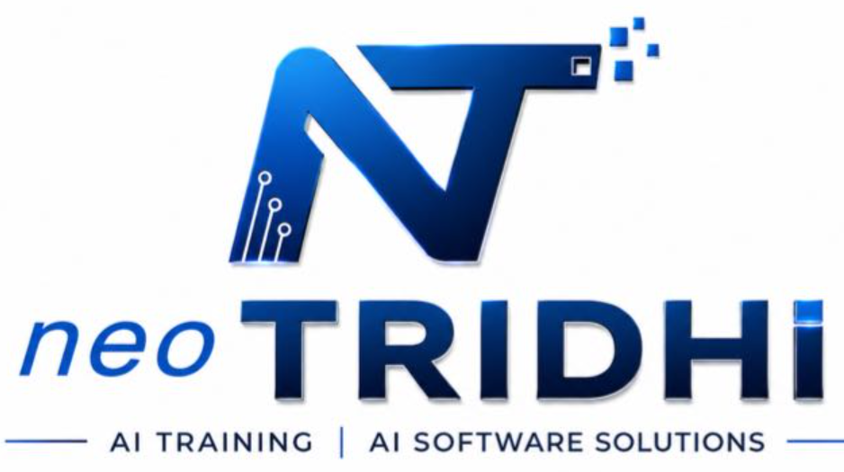
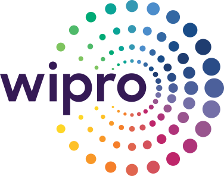
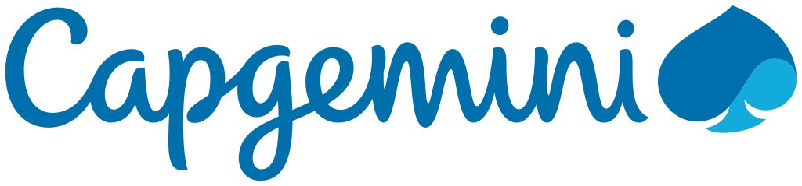
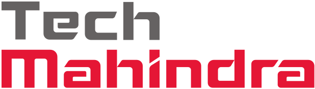

# College Placements: Campus Recruitment Training Programme

A complete placement course for **B.Tech, MCA and MBA** students by **NeoTridhi**: aptitude, verbal skills, technical skills, coding, interviews,
company-specific preparation, and how **AI** is changing hiring. Simple English, solved examples, practice sets with answers, code that runs, and
AI mock interviews on **NeoHireAI**.

> **This is the free preview.** Click a company or a module below to see it at a glance and try a few questions with full solutions.
> The complete course is available to subscribing colleges and students: [get the full course](#get-the-full-course).

## Companies

Each company page shows the recruitment process, the test pattern, official links and **5 questions with full solutions**.

<table>
<tr>
<td align="center" width="170"><a href="companies/tcs.md"> TCS</a></td>
<td align="center" width="170"><a href="companies/infosys.md"> Infosys</a></td>
<td align="center" width="170"><a href="companies/wipro.md"> Wipro</a></td>
<td align="center" width="170"><a href="companies/accenture.md"> Accenture</a></td>
</tr>
<tr>
<td align="center"><a href="companies/cognizant.md"> Cognizant</a></td>
<td align="center"><a href="companies/capgemini.md"> Capgemini</a></td>
<td align="center"><a href="companies/hcltech.md"> HCLTech</a></td>
<td align="center"><a href="companies/tech-mahindra.md"> Tech Mahindra</a></td>
</tr>
<tr>
<td align="center"><a href="companies/ltimindtree.md"> LTIMindtree</a></td>
<td align="center"><a href="companies/deloitte-usi.md"> Deloitte USI</a></td>
<td align="center"><a href="companies/ibm.md"> IBM</a></td>
<td align="center"><a href="companies/mphasis.md"><b>Mphasis</b> Mphasis</a></td>
</tr>
<tr>
<td align="center"><a href="companies/hexaware.md"><b>Hexaware</b> Hexaware</a></td>
<td align="center"><a href="companies/persistent-systems.md"><b>Persistent</b> Persistent Systems</a></td>
<td align="center"><a href="companies/product-companies.md"><b>Product companies</b> Product and startup roles</a></td>
<td align="center"><a href="companies/non-it-and-mba-recruiters.md"><b>Non-IT and MBA</b> Recruiters</a></td>
</tr>
</table>

Company names and logos are trademarks of their respective owners. They are used only to identify the companies whose public
recruitment processes this course prepares for. NeoTridhi is not affiliated with or endorsed by them. Logo sources: [assets/logos/SOURCES.md](assets/logos/SOURCES.md).

## The modules

Each module page lists every topic, previews one topic and gives a few questions with full solutions.

| # | Module | What you will be able to do |
|---|---|---|
| 1 | [Quantitative Aptitude & Logical Reasoning](modules/01-quantitative-aptitude-and-logical-reasoning.md) | Solve aptitude and reasoning sections quickly, with shortcuts and time strategy |
| 2 | [Verbal Ability & Communication Skills](modules/02-verbal-ability-and-communication.md) | Score in the verbal sections, write professional emails, speak with confidence |
| 3 | [Technical Training: Programming, Coding, Data Structures & DBMS](modules/03-technical-training.md) | Explain and use core CS concepts: programming, OOP, DSA, SQL, OS and networks |
| 4 | [Coding Practice, Mock Tests & Technical Assessments](modules/04-coding-practice-and-mock-tests.md) | Clear online coding rounds, with solved problems and full mock tests |
| 5 | [Interview Preparation: Technical & HR, Group Discussions & Resume](modules/05-interview-preparation.md) | Build a one-page resume, handle technical and HR rounds and GDs |
| 6 | [Company-Specific Recruitment Preparation](modules/06-company-specific-preparation.md) | Know each top recruiter's process, test pattern and official practice links |
| 7 | [AI and the Future of Placements](modules/07-ai-and-the-future-of-placements.md) | Understand AI-era hiring, the skills in demand, and use AI honestly to prepare |

## A suggested 12-week plan

| Week | Focus | Modules |
|---|---|---|
| 1-2 | Number system, percentages, ratio, averages; grammar basics; Python fundamentals | 1, 2, 3 |
| 3-4 | Time & work, speed & distance, P&C, probability; reading comprehension; OOP and complexity | 1, 2, 3 |
| 5-6 | Logical reasoning and data interpretation; email writing and speaking; data structures | 1, 2, 3 |
| 7-8 | Algorithms, SQL and DBMS, OS and networks; easy and medium coding problems | 3, 4 |
| 9 | Resume, LinkedIn and GitHub; HR questions; group discussions | 5 |
| 10 | Company-specific preparation for your target companies; mock tests | 4, 6 |
| 11 | Technical and HR mock interviews; AI skills and a small AI project | 5, 7 |
| 12 | Full mock tests under time, review of weak areas, final checklist | all |

## Get the full course

The full course has every topic of all 7 modules, the complete company chapters, timed mock tests, PDFs for offline reading, trainer-led
sessions at your college, and AI mock interviews for each company on **NeoHireAI**. Contact **NeoTridhi** at [neotridhi.tech](https://neotridhi.tech/).

## Honesty notes
- Practice questions are **original**, written in the style of common placement tests. Company pages link to **official** sites.
- Test patterns change every year. Each company page says when it was checked; **always confirm on the official page** before your test.

---
© 2026 NeoTridhi Private Limited.
