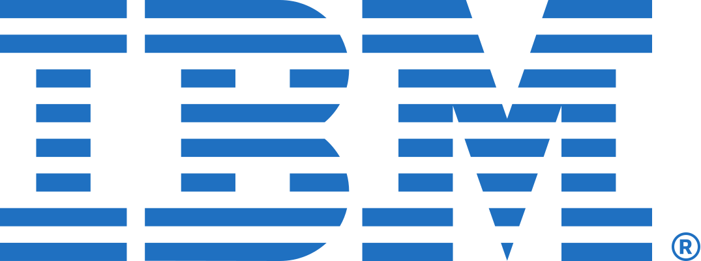

<p align="center"></p>

# IBM: placement preparation at a glance

> **Pattern as of October 2026 from public sources. Always check the official page before your test.**
> This page is a free preview of the NeoTridhi course. The full IBM chapter has 40+ questions with worked solutions, a 3-week plan,
> common traps and interview answers. [See how to get it](#get-the-full-ibm-chapter).

[Back to all companies](../README.md#companies)

---

## Quick games at a bus stop

IBM's cognitive test is like quick mobile games at a bus stop: short puzzles with numbers and patterns where speed and focus matter.
Then a normal coding test checks whether you can actually build something.

IBM's official "Application steps and tips" page lists five steps:

```
Application --> Screening --> Online Assessment --> Interview --> Decision
```

## IBM campus assessment (commonly reported; varies by role)

| Part | Reported content | Approx. time |
|---|---|---|
| Cognitive ability games | Number games, pattern and logic games; each game has a tutorial | about 30 min |
| English | Error detection, spelling, grammar, reading | about 10-30 min (varies) |
| Coding | 1-2 easy-to-medium problems on HackerRank | about 30-55 min |
| Learning agility / video (some roles) | Short behaviour or video questions | varies |

## Official links

| Link | What it is |
|---|---|
| [IBM Careers India](https://www.ibm.com/in-en/careers) | Official careers home for India. |
| [Entry-level opportunities](https://www.ibm.com/in-en/careers/career-opportunities) | Official page for entry-level roles and internships. |
| [Application steps and tips](https://www.ibm.com/in-en/careers/application-process) | Official five steps and the types of assessment. |
| [Search jobs](https://www.ibm.com/in-en/careers/search) | Official job search. |

---

## Try 5 questions (solutions open)

All questions are original, written in the style of the IBM assessment, with new numbers and wording.
IBM's cognitive tests are interactive games; these are text versions that train the same quick thinking.

**1. (Cognitive number games: missing operators)** Fill the two boxes with +, -, x or / (normal order of operations) to make it true: 9 [ ] 3 [ ] 4 = 31

<details><summary>Solution</summary>

**9 x 3 + 4 = 27 + 4 = 31.** We tried all 16 operator pairs; this is the only one that gives 31.

</details>

**2. (Cognitive deduction games: if-then)** "If it rains, the match is cancelled." The match was NOT cancelled. What follows?
(a) It rained. (b) It did not rain. (c) The match was played indoors. (d) Nothing follows.

<details><summary>Solution</summary>

If rain always leads to cancellation, and there was no cancellation, then there was no rain: **(b)**.
Trap: the reverse ("the match was cancelled, so it rained") does NOT follow; it could be cancelled for other reasons.

</details>

**3. (English: pronouns and agreement)** Correct: "Me and my friend was selected for the next round."

<details><summary>Solution</summary>

Two errors: the subject needs "I", and two people take "were". Polite order puts yourself last: **"My friend and I were selected for the next round."**

</details>

**4. (Coding: strings)** Return the longest word in a sentence. If two words tie, return the first one.
Test: "learn data and cloud skills early". Also test "" (return "").

<details><summary>Solution</summary>

`max` with `key=len` returns the FIRST longest item when there is a tie, which is what we want.

```python
def longest_word(sentence):
    words = sentence.split()
    return max(words, key=len) if words else ""

print(longest_word("learn data and cloud skills early"))
print(repr(longest_word("")))
# Output:
# skills
# ''
```
"skills" has 6 letters; "learn", "cloud" and "early" have 5. Note: "skills" wins even though "learn" comes first, because it is longer.

</details>

**5. (Interview: Git and GitHub)** "What is the difference between Git and GitHub?"

<details><summary>Solution</summary>

**Git** is a version-control tool that runs on your computer: it records snapshots (commits) of your code, lets you make branches and go back to old versions.
**GitHub** is a website that hosts Git repositories online, so teams can share code, review pull requests and track issues. Git works without GitHub; GitHub is built on Git.
Follow-up: "What is a merge conflict?" Two people changed the same lines; Git asks a person to choose the final version.

</details>

---

## 🔒 In the full IBM chapter

| Section | Locked questions (topics) |
|---|---|
| Cognitive: number games | Number target with three numbers · Comparing fractions · Mental maths · Estimation · Sequences · Rates · Ratios · Number grid · Consecutive even numbers |
| Cognitive: deduction and pattern games | Deduction · Letter pairs · Odd one out · Paper folding · Word rotations |
| English | Verb forms · Spelling (2 questions) · Prepositions · Reading |
| Coding, HackerRank style | Perfect numbers · Rotating a matrix · Merging two sorted lists, all with running Python code |
| Interview and video-style answers | Hybrid cloud · Receiving critical feedback (behavioural) · A 60-second video answer on helping someone learn |
| Also in the chapter | 10 more sample questions with answers · Questions in the style of the public exams · Common traps · A 3-week plan · How AI is changing IBM hiring |

## Get the full IBM chapter

The complete chapter, along with all 7 modules of the course and AI mock interviews on **NeoHireAI**, is available to subscribing colleges
and students. Contact **NeoTridhi** at [neotridhi.tech](https://neotridhi.tech/).

---
<sub>Company names and logos are trademarks of their respective owners. They are used here only to identify the companies whose public
recruitment processes this course prepares for. NeoTridhi is not affiliated with or endorsed by IBM. © 2026 NeoTridhi Private Limited.</sub>
